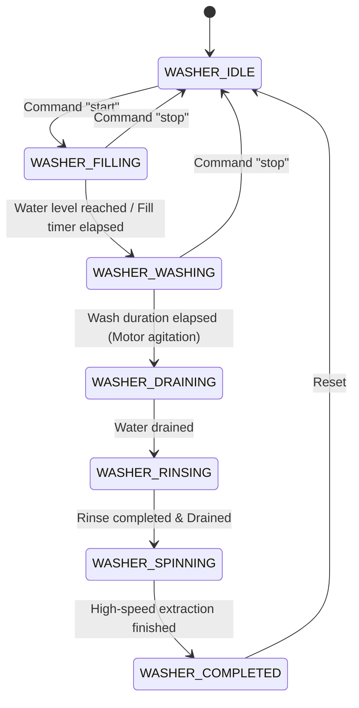

# CraftThingy ESP Washing Machine Controller (`craftthingy-esp-washing-machine`)

[-blue.svg)]()
[]()
[]()
[]()

Automated washing machine cycle state machine firmware for **ESP32** variants. Automates water fill valves, wash motor agitation, drain pumps, and spin cycles with remote REST API control and auto-updating capabilities powered by `craftthingy-esp-core-ota`.

---

## 📑 Table of Contents
1. [Features](#-features)
2. [Hardware Wiring & Pinouts](#-hardware-wiring--pinouts)
3. [Wash Cycle State Machine](#-wash-cycle-state-machine)
4. [REST API Control](#-rest-api-control)
5. [Self-Updating Architecture](#-self-updating-architecture)
6. [Arduino IDE Guide](#-arduino-ide-guide)
7. [PlatformIO Guide](#-platformio-guide)
8. [Automated CI/CD Workflow](#-automated-cicd-workflow)

---

## 🌟 Features

- **Multi-Stage Cycle Automation**: Automatically sequences Fill, Wash, Drain, Rinse, and Spin phases.
- **Relay Sequencing**: Controls high-current AC actuators safely (water inlet valve, wash motor forward/reverse agitation, drain pump).
- **Failover AP Provisioning**: If home WiFi is disconnected, broadcasts `CraftThingy-XXXX` at `192.168.4.1` for instant reconfiguration.
- **HMAC-SHA256 Rolling Key Security**: Military-grade authenticated REST API with forward secrecy.
- **Zero-Waste Flash OTA**: Downloads only its matching compiled binary (`firmware-washing_machine-esp32.bin`).

---

## 🔌 Hardware Wiring & Pinouts (ESP32)

| ESP32 Pin | Connected Relay Channel | Connected Load |
|---|---|---|
| **GPIO 12** | Relay 1 (`IN1`) | Cold Water Inlet Solenoid Valve (12V / 220V) |
| **GPIO 13** | Relay 2 (`IN2`) | Wash Agitator Motor Controller |
| **GPIO 14** | Relay 3 (`IN3`) | Water Drain Pump |
| **VIN (5V)** | Relay Board `VCC` | Relay coil power |
| **GND** | Relay Board `GND` | Common ground |

```text
               +----------------------+
               |     ESP32 DevKit     |
               |                      |
               |  GPIO12 ------------>| ---> [Relay 1: Water Valve]
               |  GPIO13 ------------>| ---> [Relay 2: Wash Motor]
               |  GPIO14 ------------>| ---> [Relay 3: Drain Pump]
               |  VIN (5V) ---------->| ---> [Relay Board VCC]
               |  GND --------------->| ---> [Relay Board GND]
               +----------------------+
```

---

## 🔄 Wash Cycle State Machine



### Stage Summary
1. **`WASHER_IDLE`**: All relays open. Waiting for cycle start.
2. **`WASHER_FILLING`**: Inlet solenoid valve energized (`GPIO 12 = HIGH`).
3. **`WASHER_WASHING`**: Agitates wash motor (`GPIO 13` pulsed) for configured wash time.
4. **`WASHER_DRAINING`**: Drain pump energized (`GPIO 14 = HIGH`) to remove soapy water.
5. **`WASHER_RINSING`**: Refills with fresh water and agitates.
6. **`WASHER_SPINNING`**: Drain pump and motor engaged simultaneously for water extraction.
7. **`WASHER_COMPLETED`**: Cycle finished, buzzer/notification sent.

---

## 🌐 REST API Control

### 1. Telemetry Status (`GET /api/status`)
```json
{
  "activeRole": "washing_machine",
  "state": "washing",
  "elapsedSeconds": 14,
  "valveActive": false,
  "motorActive": true,
  "drainActive": false
}
```

### 2. Remote Commands
Send via authenticated `POST /api/config` or use [`tools/esp_manager.html`](file:///d:/CraftThingy/esp-stuff/tools/esp_manager.html):
- **`start`**: Starts wash cycle from beginning.
- **`stop` / `pause`**: Immediately shuts off all relays.
- **`drain`**: Activates emergency drainage.

---

## 🔄 Self-Updating Architecture

Checks two repositories under `CraftThingy-Digital-Innovation`:
1. `craftthingy-esp-core-ota`: Updates underlying WiFi, security, and networking drivers.
2. `craftthingy-esp-washing-machine`: Updates wash recipes, state machine timings, and hardware logic.

---

## 🔨 Arduino IDE Guide

1. Open Arduino IDE.
2. Open [`craftthingy-esp-washing-machine.ino`](file:///d:/CraftThingy/esp-stuff/craftthingy-esp-washing-machine/craftthingy-esp-washing-machine.ino).
3. Board Configuration:
   - Board: `ESP32 Dev Module` (or your specific ESP32 variant: S3 / C3)
   - Partition Scheme: `Minimal SPIFFS (1.9MB APP with OTA)`
4. Click **Upload**.

---

## 💻 PlatformIO Guide

```bash
# Build for ESP32 Standard
pio run -e esp32dev

# Build for ESP32-S3
pio run -e esp32s3

# Build for ESP32-C3
pio run -e esp32c3

# Upload
pio run -e esp32dev -t upload
```

---

## 🤖 Automated CI/CD Workflow

Pushing a Git tag triggers [`.github/workflows/release.yml`](file:///d:/CraftThingy/esp-stuff/craftthingy-esp-washing-machine/.github/workflows/release.yml):
```bash
git tag v1.0.0
git push origin v1.0.0
```
GitHub Actions compiles binaries (`firmware-washing_machine-esp32.bin`, `firmware-washing_machine-esp32s3.bin`, `firmware-washing_machine-esp32c3.bin`) and attaches them to the release.
